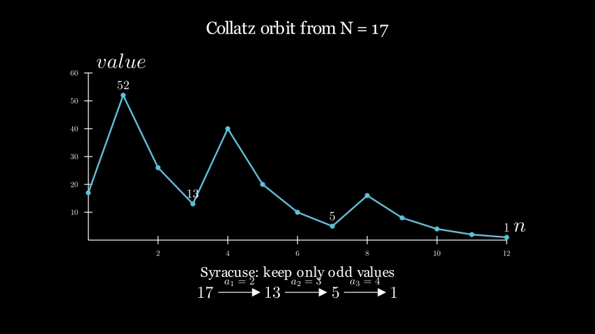

---

# [Notes] 关于陶哲轩论文“几乎所有Collatz轨道都达到几乎有界值”的一些评注 —— 第一至三部分

---

## 0. 摘要

2019年，陶哲轩(Terence Tao) 证明了关于著名的Collatz猜想的一个[新结果（逼近）：](https://terrytao.wordpress.com/2019/09/10/almost-all-collatz-orbits-attain-almost-bounded-values/)
“几乎所有考拉兹轨道都达到近似有界的值”。

这个成果在2026年显得尤为特殊。当前诸多AI正在为各类数学猜想寻找反例和证明新的界，而Tao的“模糊证明”像分界线一样站在人-机发展树的正中，既有AI暂时不擅长的几何，也有AI擅长而人不擅长的数值分析。

本评注将游览陶哲轩论文的第一部分：引论 (Introduction)。

<!--我和Deepseek旨在让每一位熟悉基础概率、群论和分析的数学本科生都能理解每一个定义、启发式论述和非平凡的概念。-->

在此过程中，我们将解释一下像 对数密度、Syracuse 加速 (acceleration)、3-adic 数、有限群、有限群上的 Fourier 特征标、几何分布、Syracuse 分布、帕斯卡分布、Haar 测度、全变差距离（total variation distance,也称 statistical distance：统计距离），以及在概率估计中起核心作用的 Chernoff 型界限之类的东西。

>本文由DeepSeek-V4 助我，请谨慎阅读。

---

## 1. Collatz 问题与部分结果

**Collatz 映射** $\operatorname{Col}:\mathbb{N}+1 \to \mathbb{N}+1$（其中$\N = \{0,1,2,\dots\}$， $\mathbb{N}+1 = \{1,2,3,\dots\}$）由以下*著名* 规则定义：

$$
{\operatorname{Col}(N) = \begin{cases}
\displaystyle{3N+1}, & \text{若 } N \text{ 为奇数},\\
N/2, & \text{若 } N \text{ 为偶数}.
\end{cases}}
$$


> “注：‘著名’是因为这个猜想满足成为‘数学疾病’的所有条件，和流行病(epidemic)一样：
I:容易理解，II:短小易传播，III：‘几乎’无法证明（如果在网上/arXiv上看到一堆关于它的修正）。
具体可参考图论学者Frank Harary被转发的[吐槽](https://improbable.com/2010/03/06/mathematical-diseases/).
总之，这个运算当年干翻了一堆美国大学，甚至一度被认为是新型的间谍干扰手段。

> 同样著名的评价来自Erdős, 1983-1985：“Mathematics is not yet ripe enough for such questions.”

给定一个起始正整数 $N$，我们可以迭代地应用 $\operatorname{Col}$ 得到 **Collatz 轨道**：

$$
\{N,\; \operatorname{Col}(N),\; \operatorname{Col}^2(N),\; \operatorname{Col}^3(N),\; \dots\}
$$

* 例，
$\operatorname{Col}^{112}(27) = \small \{27, 82, 41, 124, 62, 31, 94, 47, 142, 71, 214, 107, 322, 161, \\
484, 242, 121, 364, 182,91, 
274, 137, 412, 206, \\
103, 310, 155, 466, 233, 700, 350, 175, 526, 263, 790, 395, 1186, 593,\\ 1780, 890, 
445, 1336, 668, 334, 167, 
502, 251, 754,\\ 377, 1132, 566, 283, 850, 425, 1276, 638, 319, 958, 479, 1438,\\ 719, 2158, 1079, 3238, 1619, 4858, 2429, 7288,\\ 3644, 1822, 911, 2734, 1367, 4102, 2051, 6154, 3077,\\ 
\textcolor{blue}{9232}, 4616, 2308, 1154, 577, 1732, 866, \\433, 1300, 650, 325, 976, 488, 244,\\
 122, 61, 184, 92, 46, 23, 70, 35, 106, 53, 160, 80, 40, 20, 10, 5, 16, 8, \\
 4, 2, \textcolor{blue}{1} \}$

$\,$

**Collatz 猜想**断言，每条这样的轨道最终都会达到数字 $1$。 等价地，轨道集合的最小元素，记作

$$
\operatorname{Col}_{\min}(N) := \inf_{n\in\mathbb{N}} \operatorname{Col}^n(N),
$$

对每一个正整数$N$ 都等于 $1$。 至今无已知证明。


但看表示而不上手计算的话，我们也不免好奇轨道的最大值与最小值间的距离分布，修改规则是否会产生别的最小值或循环（参考：【Youtube】Collatz multiverse），以及像Col这样的“轨道族”的特殊代数几何结构（参考：【知乎】最大素因数与233循环）之类。


1937年至今的研究产生了一些结果。 数值计算已验证了猜想对所有 $ 2^{68}$ 以内的起始值成立(Barina, 2020)。 在理论方面，Terras  和 Everett  证明了对于“几乎所有”的 $N$（在自然密度的意义下），最小轨道值严格小于起始值。 后来，Allouche 和 Korec 将之改进为：对几乎所有的 $N$ 有 $\operatorname{Col}_{\min}(N) < N^\theta$，其中 $\theta$ 可以是任何大于 $\log 3 / \log 4 \approx 0.7924$ 的数。

所有这些结果都很脆弱：它们只保证典型轨道具有某种幂律衰减，而并未说明轨道会接近 $1$。 陶哲轩论文的主要定理（定理 1.3）将所有的脆弱压缩了：


 **定理1-3（Tao, 2019）**
设 $f:\mathbb{N}+1 \to \mathbb{R}$ 是任何当 $N\to\infty$ 时趋于 $+\infty$ 的函数。 那么对**几乎所有**的 $N\in\mathbb{N}+1$，我们有

$$
\boxed{\operatorname{Col}_{\min}(N) < f(N)}
$$
。因此，对于一个典型的起始值，轨道不仅会衰减，而且最终会小于任何预先指定的缓慢发散的界——比如小于 $f(N)=\log\log\log\log N$。至此，可以说是终结了找指数/上界的时代。

---

## 2. “几乎所有”的含义——对数密度

本文使用的“几乎所有”概念不同于通常的自然密度。 子集 $A \subset \mathbb{N}+1$ 的 **自然密度** 就是它在全集中的相对大小

$$
\lim_{x\to\infty} \frac{\#\{N\in A : N\le x\}}{x},
$$

假设该极限存在。 自然密度适用于许多加法性问题，但对于像 Collatz 映射这样的动力学，它有一个严重的缺陷：Collatz 迭代能将一个自然密度为 $1$ 的集合（如：$[1,x]$）映射到整数的某个非常稀疏的子集中（如：论文第3部分的例外集合  $E \subset [1, x^{\theta}]$，它很小（自然密度为0）：$ \forall N' \in E,\exist \operatorname{Col}_{\min}(N') \not< x^{\theta^2}$），从而破坏任何直接的迭代论证。

为克服这一点，陶哲轩使用了 **对数密度**（logarithmic density）。 直观上，对数密度给每个整数 $N$ 赋予权重 $1/N$，这使得它在乘法和除法下表现更加性、更好。

 形式上，对于非零自然数集的一个有限非空子集 $R\subset\mathbb{N}+1$，我们通过下式定义 **随机变量** $\mathbf{Log}(R)$：

$$\boxed{
\mathbb{P}(\mathbf{Log}(R) \in A) = \frac{\sum_{N\in A\cap R} \frac{1}{N}}{\sum_{N\in R} \frac{1}{N}}.
}
$$

其中**随机变量**是定义在概率空间 $(\Omega, \mathcal{F}, \mathbb{P})$ 上的实值可测函数 $X: \Omega \to \mathbb{R}$，满足对任意实数 $x$ 都有 $\{\omega \in \Omega \mid X(\omega) \le x\} \in \mathcal{F}$。
子集族 $\mathcal{F}\subseteq 2^{\Omega}$ 是 $\Omega$ 上的一个 $\sigma$-代数
$\mathbb{P}$ 是定义在可测空间 $(\Omega, \mathcal{F})$ 上的概率测度。

集合 $A$ 的对数密度便是

$$
\boxed{
\lim_{x\to\infty} \mathbb{P}\bigl(\mathbf{Log}(\mathbb{N}+1\cap[1,x]) \in A\bigr),
}
$$

如果该极限存在的话。 性质 $\textcolor{blue}{P}(N)$ 对 **几乎所有** $N$ 成立，如果它成立的集合的对数密度为 $1$，即

$$
\lim_{x\to\infty} \mathbb{P}\bigl(\mathbf{Log}(\mathbb{N}+1\cap[1,x]) \in\{ N\in\N+1: \textcolor{blue}{P}(N) \} \bigr) = 1.
$$

这里的性质$P$即参照集合论中的分离图式(Schema of Separation):
如果 $P$ 是一个性质，那么对于任意 $X$，存在集合 $Y:=\{x\in X:\textcolor{blue}{P}(x)\}$。

> **例**：正偶数的对数密度为 $1/2$。推演如下：
设 $A = 2\N+2 = \{2,4,6,\dots\} \subset \mathbb{N}+1$ 为所有偶数正整数的集合。
我们将根据定义计算其对数密度。
**步骤 1 – 将密度函数写成调和和比值的极限**
对于任意大的 $x$，对数随机变量 $\mathbf{Log}(\mathbb{N}+1 \cap [1,x])$ 落在 $A$ 中的概率为：
$$ {\mathbb{P}}_x = \frac{\displaystyle\sum_{N \in A \cap [1,x]} \frac{1}{N}}
{\displaystyle\sum_{N \in \mathbb{N}+1 \cap [1,x]} \frac{1}{N}} .
$$
如果存在，则 $A$ 的对数密度函数为 $\lim_{x\to\infty} P_x$。
**步骤 2 – 化简分子**
每个偶数 $N$ 都可以写成 $N = 2k$ 的形式，其中 $k \in \mathbb{N}+1$。
对于给定的 $x$，$[1,x]$ 中的偶数为 $2,4,\dots,2\lfloor x/2\rfloor$，$\lfloor 2.6 \rfloor=2$ 是下取整函数。因此，
$$
\sum_{N \in A \cap [1,x]} \frac{1}{N}
= \sum_{k=1}^{\lfloor x/2\rfloor} \frac{1}{2k}
= \frac12 \sum_{k=1}^{\lfloor x/2\rfloor} \frac{1}{k}.
$$
**步骤 3 – 调和级数的渐近性**
对于 $M\to+\infty$，$\sum_{k=1}^{M} \frac{1}{k} = \log M + \gamma + o(1)$ 呈对数发散，其中 $\gamma\approx 0.57721$ 是欧拉-马歇罗尼常数（Euler–Mascheroni constant）。
因此，当 $x\to\infty$ 时，
$$\begin{align*}
\sum_{N \in A \cap [1,x]} \frac{1}{N}
&= \frac12 \Bigl(\log(x/2) + \gamma + o(1)\Bigr)\\
&= \frac12 \log x - \frac12 \log 2 + \frac12 \gamma + o(1).
\\
\sum_{N=1}^{\lfloor x\rfloor} \frac{1}{N}
&= \log x + \gamma + o(1).
\end{align*}
$$
$o(1)$：表示当 $x\to\infty$ 时趋于 $0$ 的量。即  $\lim_{x\to\infty} o(1) = 0$。
**步骤 4 – 形成比值并求极限** 
$$
\lim_{x\to\infty}P_x = \lim_{x\to\infty}\frac{\frac12 \log x + (\text{常数} + o(1))}{\log x + (\text{常数} + o(1))}\\
=\lim_{x\to\infty} \frac12 \cdot \frac{\log x + O(1)}{\log x + O(1)}\\
=\frac{1}{2}.
$$ 
$O(1)$：表示有界量。即存在常数 $C$，使得 $|f(x)| \le C$ 对 $x\to\infty$ 成立


注意，具有自然密度 $1$ 的集合未必有对数密度 $1$；例如，十进制表示中以 $1$ 为首位数字的整数集合，其对数密度为 $\log_{10}2 \approx 0.301$（这就是**本福特定律**,Benford's law）。 就 自然密度蕴含对数密度但反之不成立而言，对数密度是比自然密度更严格的“巨量”概念。 在本文中，对数密度是合适的工具，因为 Collatz 映射的上下振荡会产生[类似于本福特定律的乘法扰动](#4-启发式模型为什么典型轨道会衰减) ；对数密度足够抑制这些扰动，从而使得归纳论证可行。
<!-- 深层直观：使用权重1/N相当于在对数尺度（log N）上均匀取样。Collatz映射中的乘法运算（如除以2的幂次）在对数空间变为平移，使得这种测度对轨道中的乘法扰动更具鲁棒性。 -->

---

## 3. Syracuse 表述

Collatz 映射可以通过合并步骤来“加速”。 **Syracuse 映射** $\operatorname{Syr} : 2\mathbb{N}+1 \to 2\mathbb{N}+1$（其中 $2\mathbb{N}+1$ 是正奇数集）先执行一次乘以 $3$，然后除以 $2$ 的最大可能幂次：

$$
\operatorname{Syr}(N) = \frac{3N+1}{2^{\nu_2(3N+1)}}.
$$

这里 $\nu_2(m)$ 是整除 $m$ 的 $2$ 的最高幂次。 例如，$\operatorname{Syr}(1)=1$, $\operatorname{Syr}(3)=5$, $\operatorname{Syr}(5)=1$, $\operatorname{Syr}(7)=11$。 这恰好是 Collatz 轨道的奇数部分：奇数的 Syracuse 轨道就是 Collatz 轨道中出现的奇数的子序列。 因此，

$$
\operatorname{Col}_{\min}(N) = \operatorname{Syr}_{\min}\bigl(N/2^{\nu_2(N)}\bigr).
$$


\_
这里对于任意整数 $N$，定义其 $p$进赋值(p-valuations) 如下
$$
\nu_p(N)= \begin{cases}
\max{\{a\in\N: p^a|N \}}&,N\ne 0\\
+\infty&,N=0
\end{cases}  
$$

于是 Collatz 猜想等价于对所有正奇数 $M$ 有 $\operatorname{Syr}_{\min}(M)=1$，而关于 $\operatorname{Col}$ 的主要定理等价于关于 $\operatorname{Syr}$ 的同样陈述。

$\,$

### Syracuse 在做什么

以 $N=17$ 为例，完整的 Collatz 轨道会经过许多偶数；Syracuse 则把“乘以 $3$ 加 $1$，再连续除以 $2$”合并成一步。图中的 $a_j$ 就是这一步实际除掉的 $2$ 的幂次。


如果阅读平台不渲染 Mermaid，直接把它读成两行即可：
$17\to52\to26\to13\to40\to20\to10\to5\to16\to8\to4\to2\to1$，而加速后是
$17\xrightarrow{a_1=2}13\xrightarrow{a_2=3}5\xrightarrow{a_3=4}1$。

Syracuse 映射有一个使用 **仿射映射** (affine map) 的显式描述。 对正整数 $a$，定义

$$
\operatorname{Aff}_a(x) = \frac{3x+1}{2^a}.
$$

>总的几何效果是：以一个固定的压缩比 $3/2^a$ 进行缩放，然后在实数轴上平移 $1/2^a$（任意奇数输入都可除以 $2$ 的某次幂）。

对一组n元组(向量) $\vec{a}=(a_1,\dots,a_n)$ 复合 $n$ 个这样的映射：

* **基础情形 $n=1$：**
对于单个正整数 $a_1$，
$$
\operatorname{Aff}_{a_1}(x) = \frac{3x+1}{2^{a_1}} = 3^1 2^{-a_1}x + 2^{-a_1}.
$$
根据定义 (1.5) 取 $n=1$：<!-- 原论文公式(1.5)定义了偏移映射 F_n -->
$$
F_1(a_1) = \sum_{m=1}^1 3^{1-m}2^{-a_{[m,1]}} = 3^0 2^{-a_1} = 2^{-a_1}.
$$
因此，等式 $\operatorname{Aff}_{a_1}(x) = 3^1 2^{-|\vec{a}|} x + F_1(\vec{a})$ 确实成立。

**归纳步骤：**
假设该公式对 $n-1$ 成立：
$$
\operatorname{Aff}_{a_1,\dots,a_{n-1}}(x) 
$$
现在将其与 $\operatorname{Aff}_{a_n}$ 进行复合：
$$
\operatorname{Aff}_{a_1,\dots,a_n}(x) = \operatorname{Aff}_{a_n}\!\bigl(\operatorname{Aff}_{a_1,\dots,a_{n-1}}(x)\bigr)
= \frac{3\bigl(3^{n-1} 2^{-(a_1+\dots+a_{n-1})} x + F_{n-1}\bigr) + 1}{2^{a_n}}.
$$
将 $3$ 乘入括号内，并执行除以 $2^{a_n}$ 的运算：
$$
= 3^n 2^{-(a_1+\dots+a_n)} x \;+\; \frac{3}{2^{a_n}}\,F_{n-1} \;+\; \frac{1}{2^{a_n}}.
$$ 

现在考察 (1.5) 中的 $F_n(\vec{a})$：<!-- 再次引用原论文公式(1.5) -->
$$
F_n(\vec{a}) = \sum_{m=1}^n 3^{n-m} 2^{-a_{[m,n]}}
= \underbrace{\sum_{m=1}^{n-1} 3^{n-m} 2^{-a_{[m,n]}}}_{\text{项 } m < n} \;+\; 3^{0} 2^{-a_n}.
$$
对于每一个 $m \le n-1$，记 $a_{[m,n]} = a_{[m,n-1]} + a_n$，并注意到 $3^{n-m} = 3 \cdot 3^{(n-1)-m}$：


$$
\operatorname{Aff}_{\vec{a}}(x) = \underbrace{3^n 2^{-|\vec{a}|} }_{放缩} x + \underbrace{F_n(\vec{a})}_{\text{偏移}},
$$

其中 $|\vec{a}| = a_1+\cdots+a_n$，而 **$n$-Syracuse 偏移映射** (offset map) 为

$$
F_n(\vec{a}) = \sum_{m=1}^n 3^{n-m} 2^{-(a_m+\cdots+a_n)}.
$$

这个偏移是一个分母为 $2$ 的幂的有理数——它属于环 $\mathbb{Z}[\tfrac12]= \{\frac{m}{2^a}:a\in\Z,\,m\in \Z \}$。 它刻画了迭代映射在缩放部分之外增加的一个常数漂移，即

$$
\operatorname{Aff}_{\vec a}(0) = F_n(\vec a).
$$

所以偏移可以看作“原点在 $n$ 步 Syracuse 加速迭代后的像”


如果我们定义 **$n$-Syracuse 赋值** $\vec{a}^{(n)}(N)$ 为沿前 $n$ 步的赋值元组，

$$
\vec{a}^{(n)}(N) = \bigl(\nu_2(3N+1),\; \nu_2(3\operatorname{Syr}(N)+1),\; \dots,\; \nu_2(3\operatorname{Syr}^{n-1}(N)+1)\bigr),
$$

那么

$$
\operatorname{Syr}^n(N) = \operatorname{Aff}_{\vec{a}^{(n)}(N)}(N) = 3^n 2^{-|\vec{a}^{(n)}(N)|} N + F_n(\vec{a}^{(n)}(N)).
\tag{1.7}
$$

这个显式公式是所有后续分析的基础。<!-- 公式(1.7)将轨道拆分为乘法收缩项和常数偏移项 -->

---

## 4. 启发式模型——为什么典型轨道会衰减

###  估值启发（heuristic）

等式 (1.7) 将演化分离为一个乘法部分和一个常数偏移。 对于大的 $N$ 和相对较小的 $n$，偏移 $F_n$ 可忽略（它至多为 $3^n$，而主项约为 $(3/4)^n N$）。 于是

$$
\operatorname{Syr}^n(N) \approx 3^n 2^{-|\vec{a}^{(n)}(N)|} N.
$$

关键的统计洞察，启发式 1.8，是对于一个“典型”的大奇数 $N$ 以及远小于 $\log N$ 的 $n$，元组 $\vec{a}^{(n)}(N)$ 的行为类似于 $n$ 个独立的 **均值为 $2$ 的几何分布**，记作 $\mathbf{Geom}(2)$。 这是因为：

- 对一个模 $2$ 的高次幂均匀分布的随机奇数 $N$，$\nu_2(3N+1) = a$ 的概率恰好是 $2^{-a}$。
- 在 Syracuse 映射下，产生的奇数会在剩余类之间“均匀重洗牌”，因此不同步骤的估值是独立的。

如注记 1.10 所述，这一启发式可在 2-adic 框架下严格化：Syracuse 映射保持奇 2-adic 整数上的 **Haar概率测度**（一致）。 

如果 $\mathbf{X}$ 是一个随机的奇 2-adic 整数，那么 $\nu_2(3\operatorname{Syr}^j(\mathbf{X})+1)$ 就是 i.i.d. 的 $\mathbf{Geom}(2)$。 在有限整数情境中，命题 1.9 表明，如果 $N$ 在模一个充分大的 $2$ 的幂次下接近均匀分布，那么前 $n$ 个估值在总变差意义下接近 $\mathbf{Geom}(2)^n$。

---

###  为什么轨道会收缩

单个 $\mathbf{Geom}(2)$ 变量均值为 $2$，方差为 $2$。 因此总和 $|\vec{a}^{(n)}(N)|$ 近似为 $2n$，典型波动约为 $\sqrt{n}$。 代入近似式得到

$$
\operatorname{Syr}^n(N) \approx 3^n 2^{-2n - O(\sqrt{n})} N = \exp(O(\sqrt{n})) \left(\frac{3}{4}\right)^n N
$$

因子 $(3/4)^n$ 呈指数衰减，因为 $0<3/4<1$。 乘法误差 $\exp(O(\sqrt{n}))$ 反映了随机游走 $|\vec{a}^{(n)}|$ 的高斯型波动。 对于 $n$ 达到 $c\log N$，这些波动被指数衰减压倒，因此大多数轨道迅速收缩。 这就是为什么 Collatz 轨道通常会下降的直观原因——它是负漂移 $\log(3/4)$ 与估值概率独立性相结合的结果。作者也因此才采用了对数密度而非自然密度，参考本福特定律。
<!-- 注意：这种统计收缩并不能排除极少数“黑天鹅”轨道。它们可能长时间偏离典型行为，保持较大值甚至缓慢增长。陶哲轩工作的核心难点在于精确控制这些例外轨道的比例，证明它们在对数密度下几乎不存在。 -->


---

## 5. 从局部到全局——首次穿越的稳定性

证明轨道收缩一点（局部适定性）是不够的；我们需要证明它们一路收缩到接近 $1$（几乎全局适定性）。 主要定理是从**首次穿越时间**和**首次穿越位置**的一个稳定性质推导出来的。

对于阈值 $x\ge 1$ 和一个奇数 $N$，定义

$$
T_x(N) := \inf\{n\in\mathbb{N} : \operatorname{Syr}^n(N) \le x\},
$$
并约定如果轨道从未降到 $x$ 以下，则设 $T_x(N)=\infty$ 并人为地定义首次穿越值为 $1$。 那么 **首次穿越位置** $\operatorname{Pass}_x(N)$ 便是 $\operatorname{Syr}^{T_x(N)}(N)$（或者当 $T_x(N)=\infty$ 时为 $1$）。

非正式地说，$T_x(N)$ 是轨道首次下降到至多 $x$ 的时间，$\operatorname{Pass}_x(N)$ 则是首次落入 $[1,x]$ 的具体值。 关键命题（命题 1.11）指出，对于某个非常接近 $1$ 的常数 $\alpha$（具体取 $\alpha=1.001$），以及所有充分大的 $x$，有

$$
d_{\mathrm{TV}}\bigl(\operatorname{Pass}_x(\mathbf{N}_{x^\alpha}),\; \operatorname{Pass}_x(\mathbf{N}_{x^{\alpha^2}})\bigr) \ll \log^{-c}x,
$$

其中 $\mathbf{N}_y$ 是一个取值为区间 $[y, y^\alpha]$ 中奇数且服从对数分布的随机变量。 用通俗的语言说：如果你从一个大小大约为 $x^\alpha$ 或 $x^{\alpha^2}$ 的随机奇数开始（两者都很大），那么首次降至 $x$ 以下的值的分布几乎是相同的，差异在一个极小的总变差误差内。

为什么这就足够了？ 因为它意味着起始大小的某种尺度变换下的近似不变性。 然后我们可以“重置”过程并进行迭代：将首次穿越位置的分布映射回一个类似分布的更小规模的起始数。 通过有限次这样的重置，即可将概率质量推至离有界状态任意近，从而得到$\operatorname{Syr_{min}}(N)<f(N)$。 详细论证在第 3 节；其核心是近似不变性 (1.20) 结合轨道从未抵达 $[1,x]$ 的概率的一个简单界 (1.19) 就蕴含了主要结果。<!-- (1.19)为轨道不下降概率的界；(1.20)即上述近似不变性不等式。 -->

---

## 6. 证明的三大支柱

为建立命题 1.11，陶哲轩构建了一个复杂的概率与调和分析论证，其依赖于三大支柱。
<!-- 过渡：要证明首次穿越分布的尺度不变性，必须同时精细处理除以2的幂次（局部2-adic结构）和乘以3（导致模3^n的偏移）的相互作用。这自然将我们引向2-adic和3-adic整数，以及其上的调和分析。 -->

### 命题 1.9 – $n$-Syracuse 估值的分布

该命题将启发式 1.8 定量化：如果 $\mathbf{N}$ 是一个奇随机整数，其模 $2^{n'}$ 的剩余接近均匀（在总变差意义下），且 $n' \ge (2+c_0)n$，那么元组 $\vec{a}^{(n)}(\mathbf{N})$ 在总变差意义下接近 $n$ 个 i.i.d. 的 $\mathbf{Geom}(2)$ 变量，误差为指数级小 $2^{-c_1 n}$。

证明（第 4 节）使用了一个基于引理 2.1 的计数论证，该引理将元组 $\vec{a}^{(n)}(N)$ 刻画为使 $\operatorname{Aff}_{\vec{a}}(N)$ 为奇数的唯一 $n$-元组。 这一条件迫使 $N$ 落入一个特定的奇剩余类模 $2^{|\vec{a}|+1}$。 如果 $|\vec{a}|$ 不太大，在近似均匀分布下击中该剩余类的概率约为 $2^{-|\vec{a}|}$，恰好是 $\mathbf{Geom}(2)^n$ 的概率。 对元组求和即得到总变差异。

在应用中，$\mathbf{N}_y$ 来自 $[y, y^\alpha]$ 上的对数分布。 虽然此分布并非模 $2$ 的幂次完全均匀，但对于大的 $y$ 和接近于 $1$ 的指数 $\alpha$，它足够均匀以满足命题 1.9 的假设，对 $n$ 达到 $\log y$ 的一个小倍数都成立。 因此，对于首次穿越相关的时间，估值实际上是随机的。

###  Syracuse 随机变量与精细尺度 3-adic 混合

首次穿越公式 (5.8) 将 $\operatorname{Pass}_x(\mathbf{N}_y)$ 的分布约化为涉及对元组 $\vec{a}$ 求和以及一个定义在 $\mathbb{Z}/3^{n-m_0}\mathbb{Z}$ 上的函数 $c_n$ 的表达式，该函数收集来自某个范围且与给定偏移模 $3^{n-m_0}$ 同余的数 $M$ 的贡献。<!-- 等式(5.8)把首次穿越分布写成由估值元组和模3同余类确定的和式 -->

此时，问题的 **3-adic** 方面进入舞台。 定义 **Syracuse 随机变量** (1.21)：

$$
\mathbf{Syrac}(\mathbb{Z}/3^n\mathbb{Z}) \equiv F_n(\mathbf{Geom}(2)^n) \bmod 3^n.
$$

这是一个取值于循环群 $\mathbb{Z}/3^n\mathbb{Z}$ 的随机元素。 由引理 1.12，其分布可以通过递推计算：

$$
\displaystyle{\mathbb{P}(\mathbf{Syrac}(\mathbb{Z}/3^{n+1}\mathbb{Z}) = x) = \frac{\displaystyle{\sum_{1\le a\le 2\cdot3^n :\, 2^a x \equiv 1 \bmod 3}} 2^{-a} \; \mathbb{P}\bigl(\mathbf{Syrac}(\mathbb{Z}/3^n\mathbb{Z}) = \frac{2^a x - 1}{3}\bigr)}{1 - 2^{-2\cdot 3^n}}} .
$$

这一递推表明，不同 $n$ 的 Syracuse 随机变量是相容的（模 $3^k$ 投影就得到低阶变量）。 可以将其视为一个无穷 3-adic 随机变量 $\mathbf{Syrac}(\mathbb{Z}_3)$ 的有限近似。<!-- 哈尔测度直观：在奇2-adic整数上，Syracuse映射保持唯一的平移不变概率测度（哈尔测度），这解释了估值i.i.d.的来源；而3-adic偏移的均匀混合性则类似地在模3的幂次上展现出“均匀撒沙子”的性质。 -->

所需的关键性质是 **精细尺度混合** (命题 1.14)：对任何 $1\le m\le n$，在模 $3^m$ 的陪集上放大观察时，$\mathbf{Syrac}(\mathbb{Z}/3^n\mathbb{Z})$ 的分布几乎是均匀的。 更精确地，量

$$
\mathrm{Osc}_{m,n} = \sum_{Y\in \mathbb{Z}/3^n\mathbb{Z}} \Bigl| \mathbb{P}(\mathbf{Syrac}=Y) - 3^{m-n}\sum_{Y'\equiv Y \bmod 3^m} \mathbb{P}(\mathbf{Syrac}=Y') \Bigr|
$$

满足对任意固定的 $A>0$ 有 $\mathrm{Osc}_{m,n} \ll_A m^{-A}$。 用概率语言说，这意味着给定 $\mathbf{Syrac}$ 模 $3^m$ 的值，其模 $3^n$ 的剩余在 $3^{n-m}$ 个可能值中几乎均匀分布。 误差比 $m$ 的任何多项式衰减得都快。

为什么这一性质如此强大？ 在首次穿越公式中，对元组的求和涉及对模 $3^{n-m_0}$ 求值的偏移。 精细尺度混合允许我们将高模数的 Syracuse 随机变量替换为其在较低模数 ($m_0$) 上的投影，从而有效地将表达式与 $n$ 的具体值（进而与依赖于 $y$ 的区间 $I_y$）解耦。 引入的误差为 $O(\log^{-c}x)$，而得到的主项 $Z$ 则与 $y = x^\alpha$ 还是 $x^{\alpha^2}$ 无关。 这正是证明稳定性 (1.20) 所需要的。

###  Fourier 衰减与更新过程

精细尺度混合是一个关于 $\mathbf{Syrac}(\mathbb{Z}/3^n\mathbb{Z})$ 的概率质量如何分布在陪集上的命题。 等价地，根据 Plancherel 定理（有限阿贝尔群上的 Fourier 分析），它是关于 **Fourier 系数** 的命题：

$$
\widehat{\mathbb{P}}(\xi) = \mathbb{E}\, e^{-2\pi i \xi \mathbf{Syrac}/3^n},
\qquad \xi \in \mathbb{Z}/3^n\mathbb{Z}.
$$

一个分布在尺度 $3^{-m}$ 上均匀，当且仅当其 Fourier 系数对所有不在该尺度零化子中的频率 $\xi$ 为零，即那些不被 $3^{n-m}$ 整除的 $\xi$。 因此，要证明命题 1.14，只需界定所有这些 Fourier 系数。 最困难的是“高”频率——那些根本不被 $3$ 整除的 $\xi$。 命题 1.17 断言，对每个这样的 $\xi$，

$$
\bigl| \mathbb{E}\, e^{-2\pi i \xi \mathbf{Syrac}(\mathbb{Z}/3^n\mathbb{Z})/3^n} \bigr| \ll_A n^{-A},
$$
对任意 $A>0$ 成立。 换言之，Syracuse 分布的 Fourier 变换随 $n$ 增长而超多项式地衰减。
<!-- 类比：将Syracuse随机变量模3^n的分布想象成在圆周上撒沙子。精细尺度混合意味着无论我们放大到多细的3-adic尺度，沙子都铺得极其平坦，没有任何频率（傅里叶系数）出现异常堆积。 -->

对此特征函数的估计占据了论文中最长且技术性最强的部分（第 7 节）。 其思想是将显式公式

$$
\mathbf{Syrac} \equiv \sum_{j=1}^n 3^{j-1} 2^{-(a_1+\cdots+a_j)} \bmod 3^n,
$$

中的求和项配对，并将问题转化为一个关于 **二维更新过程** 的问题。 具体地，将几何变量两两分组：令 $\mathbf{b}_j = \mathbf{a}_{2j-1}+\mathbf{a}_{2j}$，它们是 i.i.d. 的帕斯卡（负二项）分布。 $\mathbf{b}_j = 3$ 的位置（概率为 $1/4$）形成 $\mathbb{Z}^2$ 中的随机游走 $\mathbf{v}_1, \mathbf{v}_{[1,2]}, \dots$ 的步长。 每一步是一个“持有时间” $\mathbf{Hold} = (\mathbf{j}, \mathbf{l})$ 的独立副本，其中 $\mathbf{j}\sim \mathbf{Geom}(4)$，而 $\mathbf{l}$ 则是直到第一个 $3$ 为止的 $\mathbf{b}$ 的和。

Fourier 系数变成因子 $f(3^{2j-2}2^{-\mathbf{b}_{[1,j]}}, \mathbf{b}_j)$ 的乘积的期望。 对于白点——那些某个三角表达式很小的点——该因子显著小于 $1$。 问题归结为证明更新过程在跨出兴趣范围之前几乎必然会遇到足够多的“白”点。 黑点（该因子接近 $1$）的确定性结构通过初等数论进行分析：它们形成格点中一组相互分离得很好的三角形。 随后对垂直坐标的一个精密的归纳法证明了所需的界。

整个论证是“概率数论”的杰作：它将一个本质上是算术的关于确定型映射的问题翻译成随机游走与 Fourier 分析的语言，然后用几何和分析工具解决该随机问题。

---

## 7. 关键技术与记号

要完全理解证明，必须熟悉出现在第 1–2 节中的若干定义和引理。 我们将它们收集于此。

###  几何分布与相关分布

---

**几何分布** $\mathbf{Geom}(\mu)$（定义 1.7）：对 $\mu>1$，

$$
\mathbb{P}(\mathbf{Geom}(\mu)=a) = \frac{1}{\mu} \left(1-\frac{1}{\mu}\right)^{a-1}, \qquad a=1,2,3,\dots
$$

整个证明过程只用到了几何随机变量$\mathbf{Geom}(2)$、$\mathbf{Geom}(4)$ 。
当 $\mu=2$ 时，
$$
\mathbf{\vec{a}} \equiv \mathbf{Geom}(2)
$$
简化为 $\mathbb{P}=2^{-a}$。 当 $\mu=4$ 时，均值为 $4$。

**帕斯卡（负二项）分布**：两个独立的 $\mathbf{Geom}(2)$ 之和为

$$
\mathbb{P}(\mathbf{Pascal}=b) = \frac{b-1}{2^b}, \qquad b\ge 2.
$$

这在将几何变量两两分组时出现。

>**二维持有时间** $\mathbf{Hold}$：在后续插黑色三角形的时候会定义。

###  总变差距离

对于同一空间 $R$ 上的两个离散随机变量 $\mathbf{X},\mathbf{Y}$，论文采用未归一化的 $L^1$ 概率距离，并将其记作总变差距离：

$$
d_{\mathrm{TV}}(\mathbf{X},\mathbf{Y}) = \sum_{r\in R} \bigl| \mathbb{P}(\mathbf{X}=r) - \mathbb{P}(\mathbf{Y}=r) \bigr|.
$$

它满足
$$\sup_{E\subset R} |\mathbb{P}(\mathbf{X}\in E) - \mathbb{P}(\mathbf{Y}\in E)|  \le  d_{\mathrm{TV}}(\mathbf{X},\mathbf{Y}) \le 2 \sup_{E\subset R} |\mathbb{P}(\mathbf{X}\in E) - \mathbb{P}(\mathbf{Y}\in E)|$$
。 标准概率论有时把上式再乘以 $1/2$；两种约定只差一个绝对常数，不影响本文中的 $\ll$ 估计，但阅读原论文时必须保持同一约定。总变差小意味着两个分布几乎无法区分。该度量用来量化复杂随机变量与简单模型的接近程度。


###  3-adic 数与特征标

这里的“3-adic”先不要理解成一套全新的实数。对本文而言，最实用的入口是：模 $3^n$ 的剩余类可以看成一个只保留前 $n$ 个三进制低位的地址；从模 $3^n$ 降到模 $3^m$（$m<n$），就是把较高的 $n-m$ 个三进制位忘掉。因此，$3$-进整数可以粗略地看成一串彼此相容的地址
$$
x\bmod 3,\quad x\bmod 3^2,\quad x\bmod 3^3,\quad \dots.
$$
这正是论文需要的“逐层观察”方式，并不要求读者先掌握完整的 $3$-进分析。

群 $\mathbb{Z}/3^n\mathbb{Z}$ 是模 $3^n$ 的剩余类组成的循环群。

其**特征标**（character，不是 characteristic）是
$$
\chi_\xi(Y)=e^{-2\pi i\xi Y/3^n},\qquad \xi\in\mathbb{Z}/3^n\mathbb{Z}.
$$
把这个复数想成单位圆上的一个箭头：$Y$ 改变时，箭头转过不同的角度。若 $Y$ 的分布很均匀，许多方向会互相抵消；例如模 $3$ 上均匀分布时
$$
1+e^{-2\pi i/3}+e^{-4\pi i/3}=0.
$$
因此 Fourier 系数的绝对值小，直观上就是“各个方向的箭头抵消得很好”。命题 1.17 中的期望正是 Syracuse 分布在频率 $\xi$ 处的 Fourier 系数；Fourier 反演公式和 Plancherel 定理把这种“箭头抵消”翻译回剩余类上的概率接近均匀。

论文偶尔提及 $3$-进整数 $\mathbb{Z}_3$，可以把它理解成上面那串相容地址的集合。


###  Chernoff 型界（引理 2.2）

该引理是对具有指数尾的格点随机游走的一个定量集中估计。假设 $\mathbf{v}$ 是 $\mathbb{Z}^d$ 中的一个随机向量，具有指数尾
$$
\mathbb{P}(|\mathbf{v}|\ge \lambda)\ll e^{-c_0\lambda},
$$
并且不几乎处处落在某个真子群的陪集内。令 $\mathbf{v}_1,\dots,\mathbf{v}_n$ 为 i.i.d. 副本，$\mathbf{v}_{[1,n]}=\mathbf{v}_1+\cdots+\mathbf{v}_n$，则

$$
\mathbb{P}(\mathbf{v}_{[1,n]} = \vec{L}) \ll \frac{1}{(n+1)^{d/2}} G_n\bigl(c(\vec{L}-n\vec{\mu})\bigr),
$$
其中 $\vec\mu=\mathbb E\mathbf v$，$G_n(x)=e^{-|x|^2/n}+e^{-|x|}$。

本科生可以先只记住它的意思：做 $n$ 次独立加法后，结果通常在平均位置 $n\vec\mu$ 附近；离平均位置越远，概率越小。对 $\mathbf v=\mathbf{Geom}(2)$，平均每一步增加 $2$，所以 $n$ 步总和通常在 $2n$ 附近。论文用这个界控制“典型路径”和二维更新过程的异常偏离；它本身不是完整的中心极限定理，也不负责把轨道一直推进到 $1$。

### 引理 2.1 – 估值元组的唯一确定

该引理断言，对于给定的奇数 $N$ 和长度 $n$，元组 $\vec a^{(n)}(N)$ 是使 $\operatorname{Aff}_{\vec a}(N)$ 为奇数的唯一 $n$-正整数组。它通过 $\operatorname{Aff}_a$ 的定义和归纳法证明。对后面的计数论证而言，关键后果是：事件 $\vec a^{(n)}(N)=\vec a$ 迫使 $N$ 落入一个特定的奇剩余类模 $2^{|\vec a|+1}$，于是可以用同余类的大小估计路径概率。
## 8. 第 2 节：两个基础引理

> **本科生导读。** 读第 8--10 节时，可以把符号分成三层：
> 1. $a_j$ 记录第 $j$ 次 Syracuse 步骤除掉了多少个 $2$；$a_{[1,j]}=a_1+\cdots+a_j$ 是到第 $j$ 步为止的总除法次数。
> 2. $\operatorname{Aff}_{\vec a}$ 是把一条指定的 $a$-路径一次性写出来的公式；引理 2.1 说，同一个奇数 $N$ 不会对应两条不同的合法路径。
> 3. 后文的 $3$-进和 Fourier 语言，只是在追踪仿射公式中的偏移量 $F_n(\vec a)$ 在模 $3^n$ 下怎样分布。先把它看成“按三进制低位逐层观察”，不必一开始就使用 $3$-进整数的完整理论。

### 8.1 先把“路径”变成一个可计数的同余条件

前文的仿射公式

$$
\operatorname{Aff}_{\vec a}(N)=3^n2^{-|\vec a|}N+F_n(\vec a)
$$

还没有说明一个关键事实：给定 $N$ 和长度 $n$，究竟有多少个正整数元组 $\vec a$ 能够使这个仿射表达式成为奇整数？论文第 2 节的引理 2.1 给出答案：恰好一个。

**引理 2.1（$n$-Syracuse 赋值的描述）**　对奇正整数 $N$ 和 $n\in\mathbb N$，$\vec a^{(n)}(N)$ 是满足

$$
\operatorname{Aff}_{\vec a}(N)\in 2\mathbb N+1
$$

的唯一元组 $\vec a\in(\mathbb N+1)^n$。

存在性来自真实的 Syracuse 轨道：每一步取
$a_j=\nu_2(3\operatorname{Syr}^{j-1}(N)+1)$，所以输出确实是奇数。唯一性可以归纳证明。若一个候选元组 $\vec a=(a_1,\ldots,a_n)$ 使最后的输出为奇数，则

$$
2^{a_n}\operatorname{Aff}_{\vec a}(N)
 =3\operatorname{Aff}_{a_1,\ldots,a_{n-1}}(N)+1.
$$

左边是偶整数，因此右边说明 $3\operatorname{Aff}_{a_1,\ldots,a_{n-1}}(N)$ 是奇整数。另一方面，前 $n-1$ 步仿射值属于 $\mathbb Z[1/2]$；一个属于这个环、乘以 $3$ 后又成为奇整数的数，只能是奇整数本身。于是前 $n-1$ 步输出也是奇整数，归纳假设锁定了前 $n-1$ 个指数，最后一个指数也只能是相应的 $2$-赋值。

例如 $N=17$ 时，

$$
17\xrightarrow{\,a_1=2\,}13\xrightarrow{\,a_2=3\,}5,
\qquad \operatorname{Aff}_{(2,3)}(17)=5.
$$

其他正整数元组不可能把 $17$ 经过两次同样的仿射操作后送到奇整数。更重要的是，固定 $\vec a$ 后，奇性条件等价于一个唯一的奇剩余类条件

$$
N\equiv b(\vec a)\pmod {2^{|\vec a|+1}}.
$$

这是因为 $3^n$ 在模 $2^{|\vec a|+1}$ 下可逆。于是“路径等于 $\vec a$”可以由一个同余类来计数，而不必逐个模拟所有轨道。

### 8.2 Chernoff 型界：典型路径为什么集中

论文的引理 2.2 是后面所有“异常事件很小”陈述的统一工具。对取值于 $\mathbb Z^d$ 的随机向量 $\mathbf v$，假设

1. $\mathbb P(|\mathbf v|\ge \lambda)\ll e^{-c_0\lambda}$，即有指数尾；
2. $\mathbf v$ 不几乎处处落在某个真子群的陪集内，即没有隐藏的格点退化。

令 $\boldsymbol\mu=\mathbb E\mathbf v$，令 $\mathbf v_{[1,n]}=\mathbf v_1+\cdots+\mathbf v_n$，并定义

$$
G_n(x)=e^{-|x|^2/n}+e^{-|x|}
$$

（$n=0$ 时按 $G_0(x)=e^{-|x|}$ 理解）。则对某个常数 $c>0$，有

$$
\mathbb P(\mathbf v_{[1,n]}=\mathbf L)
 \ll \frac{1}{(n+1)^{d/2}}G_n\bigl(c(\mathbf L-n\boldsymbol\mu)\bigr),
$$

以及

$$
\mathbb P\bigl(|\mathbf v_{[1,n]}-n\boldsymbol\mu|\ge\lambda\bigr)
 \ll G_n(c\lambda).
$$

这不是在声称一个完整的中心极限定理，而是一个足够粗、但对尾部非常有用的局部集中估计。证明用傅里叶反演和矩母函数的复平移：零频率附近由协方差给出高斯衰减，远离零频率时由非退化条件得到统一收缩，再按偏差大小选择平移量。

对 $\mathbf v=\mathbf{Geom}(2)$，均值是 $2$，因此

$$
|\mathbf{Geom}(2)^n|=2n+O_{\mathbb P}(\sqrt n)
$$

的直观版本可以被定量化。论文用它控制估值总和超过阈值的概率，以及后面所有部分和偏离 $2(j-i)$ 的概率。要注意：这一步只控制“典型的短时间路径”；它本身不能把一个轨道一直控制到有界区域。

---

## 9. 第 3 节：首次穿越稳定性如何推出主定理

### 9.1 首次穿越时间与位置

对阈值 $x\ge1$ 和奇数 $N$，定义

$$
T_x(N):=\inf\{n\in\mathbb N:\operatorname{Syr}^n(N)\le x\}.
$$

如果轨道从未降到 $x$ 以下，就规定 $T_x(N)=+\infty$。再定义首次穿越位置

$$
\operatorname{Pass}_x(N):=\operatorname{Syr}^{T_x(N)}(N),
$$

并人为约定 $\operatorname{Syr}^{+\infty}(N)=1$。因此，当首次穿越确实发生时，$\operatorname{Pass}_x(N)$ 是轨道第一次进入 $[1,x]$ 的点；若不发生，约定会把它写成 $1$，所以证明中必须同时控制 $\mathbb P(T_x=+\infty)$。

固定一个足够接近 $1$ 的数；论文为具体起见取

$$
\alpha=1.001.
$$

对足够大的 $y$，令

$$
\mathbf N_y\equiv \operatorname{Log}\bigl((2\mathbb N+1)\cap[y,y^\alpha]\bigr).
$$

也就是说，$\mathbf N_y$ 在一个很窄的乘法区间内按 $1/N$ 加权抽样。论文命题 1.11 是整个证明的“门”：对某个绝对常数 $c>0$，当 $x$ 足够大时，

$$
\mathbb P\bigl(T_x(\mathbf N_y)=+\infty\bigr)\ll x^{-c},
\qquad y=x^\alpha,\ x^{\alpha^2},
\tag{9.1}
$$

并且

$$
d_{\mathrm{TV}}\bigl(\operatorname{Pass}_x(\mathbf N_{x^\alpha}),
\operatorname{Pass}_x(\mathbf N_{x^{\alpha^2}})\bigr)
\ll (\log x)^{-c}.
\tag{9.2}
$$

第二个估计的意思不是“两个原始起点相等”，而是：起点规模分别约为 $x^\alpha$ 和 $x^{\alpha^2}$ 时，首次落入 $[1,x]$ 后落在哪个奇数上的概率几乎相同。这里的近似运输只在首过位置的分布层面成立。

### 9.2 迭代这个门：$B_x$ 事件

令

$$
E_{N_0}:=\{N\in2\mathbb N+1:\operatorname{Syr}_{\min}(N)\le N_0\}
$$

表示从 $N$ 出发最终能到达 $N_0$ 或更小的起点集合。对每个尺度 $x$，设

$$
B_x:=\{T_x(\mathbf N_{x^\alpha})<+\infty,\quad
\operatorname{Pass}_x(\mathbf N_{x^\alpha})\in E_{N_0}\}.
$$

若更大的样本 $\mathbf N_{x^{\alpha^2}}$ 先穿过 $x$，且其首过位置属于 $E_{N_0}$，那么它在到达 $x$ 之前必然已经穿过 $x^\alpha$。较早的首过位置的 Syracuse 后续轨道包含较晚首过位置的后续轨道，所以较早位置的最小轨道值也不超过 $N_0$。命题 1.11 给出

$$
\mathbb P(B_{x^\alpha})
\ge \mathbb P(B_x)-O((\log x)^{-c}).
\tag{9.3}
$$

其中 $T_x=+\infty$ 的概率贡献由 (9.1) 吸收，首过位置分布的差异由 (9.2) 吸收。这就是“从大尺度把质量往小尺度搬运”的方向：每次把阈值从 $x$ 换成 $x^\alpha$，起点分布就向更大的乘法区间移动一次。

### 9.3 从局部区间到任意大的起点

给定 $N_0$，选取 $J$ 使得

$$
y=x^{\alpha^{-J}}<N_0^{1/\alpha},
$$

且 $J$ 是满足该条件的第一个整数。于是

$$
N_0^{1/\alpha^2}\le y,\qquad y^{\alpha^J}=x.
$$

底端事件 $B_{y^{\alpha^{-1}}}$ 使用的随机起点是 $\mathbf N_y$；由于 $\mathbf N_y\le y^\alpha<N_0$，除去不穿越阈值的稀有事件后，它几乎自动属于 $E_{N_0}$。从 (9.3) 沿着尺度链求和，得到

$$
\mathbb P(B_{x^{1/\alpha}})
\ge 1-O((\log y)^{-c})
\ge1-O((\log N_0)^{-c}).
\tag{9.4}
$$

而 $B_{x^{1/\alpha}}$ 的起点正是 $\mathbf N_x$。其首过点位于从 $\mathbf N_x$ 出发的 Syracuse 轨道中，因此

$$
\mathbb P\bigl(\operatorname{Syr}_{\min}(\mathbf N_x)>N_0\bigr)
\ll (\log N_0)^{-c}.
\tag{9.5}
$$

这一步非常值得停下来理解：没有一个固定的 $x$ 被“无限次强行迭代”。真正被迭代的是一族相邻的对数均匀分布，以及它们的首过位置分布之间的近似一致性。

### 9.4 Theorem 3.1：有限区间中的定量结论

把 (9.5) 展开为对数权重，并用调和级数估计 $[x,x^\alpha]$ 的总质量，得到论文定理 3.1：对 $N_0\ge2$ 和 $x\ge2$，

$$
\frac1{\log x}
\sum_{\substack{N\in(2\mathbb N+1)\cap[1,x]\\
\operatorname{Syr}_{\min}(N)>N_0}}
\frac1N
\ll \frac1{(\log N_0)^c}.
\tag{9.6}
$$

等价地，

$$
\mathbb P\left(
\operatorname{Syr}_{\min}\bigl(\operatorname{Log}((2\mathbb N+1)\cap[1,x])\bigr)
\le N_0\right)
\ge1-O((\log N_0)^{-c}).
\tag{9.7}
$$

这是比主定理更强、也更适合迭代的有限尺度版本。它先给定一个固定的 $N_0$，再让 $x$ 变大；误差只由 $N_0$ 控制。

从奇数起点回到全体正整数时，需要小心归一化。若 $\nu_2(N)=a$，写 $N=2^aM$ 且 $M$ 为奇数，则

$$
\sum_{\substack{N\le x\\\nu_2(N)=a}}\frac1N
=2^{-a}\sum_{\substack{M\le x/2^a\\M\ {\rm odd}}}\frac1M
\sim 2^{-a-1}\log x.
$$

因此在全体正整数的对数密度中，该层的质量是 $2^{-a-1}$；若把奇数层本身重新归一化为总质量 $1$，相对质量才是 $2^{-a}$。有限层 $0\le a\le a_0$ 的全局质量趋于 $1$，再令 $a_0\to\infty$，即可得到 Collatz 版本的结论。

### 9.5 让 $N_0$ 缓慢增长

先在奇数上取任意满足 $f(N)\to\infty$ 的函数，并设

$$
\widetilde f(x):=\inf_{\substack{N\in2\mathbb N+1\\N\ge x}}f(N).
$$

则 $\widetilde f(x)\to\infty$。在 (9.6) 中取 $N_0=\widetilde f(x)$，得到异常集合的对数权重上界

$$
\sum_{\substack{N\le x\\
\operatorname{Syr}_{\min}(N)>f(N)}}\frac1N
\ll\frac{\log x}{(\log\widetilde f(x))^c}=o(\log x).
$$

异常集合的对数密度为零，故

$$
\operatorname{Syr}_{\min}(N)<f(N)
$$

对对数密度意义下几乎所有奇数成立；再用上一小节的 $2$-赋值分层，就得到原论文定理 1.3。

### 9.6 这仍然不是 Collatz 猜想

这里有三层不能混淆的量词：

1. 定理 1.3 对每一个预先给定的发散函数 $f$ 都成立，但“几乎所有”是对数密度 $1$，不是所有整数。
2. 它等价于：对任意 $\delta>0$，存在 $C_\delta$，使得 $\operatorname{Col}_{\min}(N)\le C_\delta$ 的集合具有至少 $1-\delta$ 的下对数密度；论文给出的量级是 $C_\delta\ll\exp(\delta^{-O(1)})$。
3. 这不提供一个对所有 $N$ 都适用的固定常数 $C$，更不证明每条轨道到达 $1$。论文的 Remark 1.4 明确指出，固定常数版本可能已经接近完整 Collatz 猜想的难度。

---

## 10. 第 4--7 节：稳定性命题的技术桥梁

### 10.1 从 2-adic 估值转到 3-adic 偏移

由 (1.7)，当 $0\le k\le n$ 时，乘法项

$$
3^n2^{-\lvert\vec a^{(n)}(N)\rvert}N
$$

在模 $3^k$ 下为零，所以

$$
\operatorname{Syr}^n(N)\equiv F_n(\vec a^{(n)}(N))\pmod {3^k}.
\tag{10.1}
$$

命题 1.9 又告诉我们，在合适的对数区间中，$\vec a^{(n)}(N)$ 可以用 $\mathbf{Geom}(2)^n$ 替代，误差为指数小量。因此引入

$$
\mathbf{Syrac}(\mathbb Z/3^n\mathbb Z)
\equiv F_n(\mathbf{Geom}(2)^n)\pmod {3^n}.
\tag{10.2}
$$

它不是把 Syracuse 映射直接改造成一个均匀随机函数，而是一个由独立几何变量驱动的有限 $3$-进随机变量。

### 10.2 递推分布与一个精确算例

令 $p_n(x)=\mathbb P(\mathbf{Syrac}(\mathbb Z/3^n\mathbb Z)=x)$。把最后一个几何变量单独拿出来，利用 $\mathbf{Syrac}_{n+1}\equiv(3\mathbf{Syrac}_n+1)/2^{\mathbf{Geom}(2)}$，论文引理 1.12 给出

$$
p_{n+1}(x)=
\frac{\displaystyle\sum_{\substack{1\le a\le2\cdot3^n\\2^ax\equiv1\pmod3}}
2^{-a}\,p_n\left(\frac{2^ax-1}{3}\right)}
{1-2^{-2\cdot3^n}}.
\tag{10.3}
$$

括号内的自变量按模 $3^n$ 解释，分母是把一个完整周期内的几何权重归一化。以 $p_0(0)=1$ 为起点，直接用有理数计算得到：

$$
\begin{array}{c|ccc}
n=1,\ x\pmod3&0&1&2\\ \hline
p_1(x)&0&1/3&2/3
\end{array}
$$

以及

$$
\begin{array}{c|rrrrrrrrr}
x\pmod9&0&1&2&3&4&5&6&7&8\\ \hline
63p_2(x)&0&8&16&0&11&4&0&2&22
\end{array}.
$$

这些数的和为 $1$。这两个小例子有两个作用：第一，它们复核了递推式的方向和归一化；第二，它们显示 $\mathbf{Syrac}$ 在粗尺度上绝非均匀分布，例如模 $3$ 的 $0$ 类永远没有质量。论文要证明的不是“全局均匀”，而是条件在一个较粗的 $3$-adic 类以后，剩余细位近似均匀。

还可以把第二张表当作一个小型“混合”练习。模 $3$ 的 $1$ 类包含 $1,4,7$，它们的概率分子是 $8,11,2$，总和为 $21$；如果这一类内部完全均匀，三个分子本应都等于 $7$。模 $3$ 的 $2$ 类则对应 $16,4,22$，总和为 $42$，完全均匀时应各为 $14$。在 $n=2$ 这么小的尺度上偏差还很明显，这并不和命题 1.14 矛盾；命题说的是随着粗尺度 $m$ 增大，细位的总体偏差按任意固定的多项式阶衰减。

### 10.3 精细尺度混合等价于高频 Fourier 衰减

对 $1\le m\le n$，论文定义尺度 $3^{-m}$ 的振荡量

$$
\operatorname{Osc}_{m,n}(c_Y):=
\sum_{Y\in\mathbb Z/3^n\mathbb Z}
\left|c_Y-3^{m-n}
\sum_{\substack{Y'\in\mathbb Z/3^n\mathbb Z\\Y'\equiv Y\pmod{3^m}}}c_{Y'}\right|.
$$

命题 1.14 断言，对 $c_Y=p_n(Y)$，任意固定 $A>0$ 都有

$$
\operatorname{Osc}_{m,n}(p_n)\ll_A m^{-A}.
\tag{10.4}
$$

它的严格概率含义是：对每个模 $3^m$ 陪集，把该陪集的总质量平均分配到其中 $3^{n-m}$ 个细类后，所有陪集的全局 $L^1$ 偏差都很小；对质量非零的陪集，才可以等价地说条件分布近似均匀。这里的“几乎”是对每一个 $A$ 都能得到多项式衰减，而不是已经证明了 $e^{-cm}$。

有限循环群上的 Fourier 系数为

$$
\widehat p_n(\xi)=
\mathbb E\exp\left(-\frac{2\pi i\xi\mathbf{Syrac}(\mathbb Z/3^n\mathbb Z)}{3^n}\right).
$$

若 $3\nmid\xi$，该字符在每个模 $3^{n-1}$ 的陪集上平均为零。因此命题 1.14 的细尺度振荡和命题 1.17 的估计

$$
|\widehat p_n(\xi)|\ll_A n^{-A}
\tag{10.5}
$$

本质上是同一个事实的空间表述与频率表述。第 6 节用 Plancherel 定理把 (10.5) 推回 (10.4)；反过来，对最高层陪集使用三角不等式也能得到反向控制。

### 10.4 第 5 节怎样使用混合

为了处理首过时间未知的问题，论文取

$$
n_0=\left\lfloor\frac{\log x}{10\log2}\right\rfloor,
\qquad
m_0=\left\lfloor\frac{\alpha-1}{100}\log x\right\rfloor.
$$

典型几何路径的部分和满足 $a_{[1,j]}=2j+O(\log^{0.6}x)$，因此首过时间集中在区间

$$
I_y=\left[
\frac{\log(y/x)}{\log(4/3)}+\log^{0.8}x,
\frac{\log(y^\alpha/x)}{\log(4/3)}-\log^{0.8}x
\right].
$$

这正是平均收缩率 $(3/4)^j$ 在带误差时的对数版本。论文命题 5.2 把首过位置的概率改写成

$$
\mathbb P(\operatorname{Pass}_x(\mathbf N_y)\in E)
=\sum_{n\in I_y}\sum_{\vec a\in A^{(n-m_0)}}
\sum_{M\in E'}
\mathbb P(\operatorname{Aff}_{\vec a}(\mathbf N_y)=M)
+O((\log x)^{-c}).
\tag{10.6}
$$

这里有两个容易被一眼带过、但实际很重要的集合。令 $r=n-m_0$，论文把“典型元组”记为
$$
A^{(r)}:=\left\{\vec a\in(\mathbb N+1)^r:
\left|a_{[1,j]}-2j\right|<(\log x)^{0.6}
\ \text{对所有 }0\le j\le r\right\}.
$$
也就是说，$A^{(r)}$ 只保留那些部分和始终贴近平均直线 $2j$ 的路径。这里的 $A$ 实际上依赖于 $x$，为减轻记号，论文把这个下标省略了。

若 $E\subset (2\mathbb N+1)\cap[1,x]$，则
$$
\begin{aligned}
E':=\{M\in2\mathbb N+1:\;&T_x(M)=m_0,\quad
\operatorname{Pass}_x(M)\in E,\\
& e^{-(\log x)^{0.7}}(4/3)^{m_0}x
\le M\le e^{(\log x)^{0.7}}(4/3)^{m_0}x\}.
\end{aligned}
$$
它收集的是这样一些中间点 $M$：从 $M$ 出发，恰好再走 $m_0$ 步时首次落入 $[1,x]$，落点属于 $E$，并且 $M$ 没有偏离“平均反向尺度”太远。于是 (10.6) 的三重求和可以用一句话读成：枚举典型路径、枚举可能的中间点，再把它们出现的概率加起来。关键变化是：右端不再显式出现随机首过时间，只剩下求和区间 $I_y$ 和输入分布 $\mathbf N_y$ 对 $y$ 的依赖。

把仿射式在 $m_0$ 步处拆开后，剩余偏移量只通过模 $3^{n-m_0}$ 的 $\mathbf{Syrac}$ 出现。由于 $n-m_0\ge m_0$，命题 1.14 可以把不同 $n$ 的高位分布替换为同一个模 $3^{m_0}$ 的主项，误差为 $O((\log x)^{-c})$。于是 $y=x^\alpha$ 和 $y=x^{\alpha^2}$ 的主项一致，这就给出了命题 1.11 的 (9.2)。

### 10.5 第 7 节的“白点--黑三角形”机制

把 (10.2) 中的变量倒序后，随机变量可写为

$$
X_n\equiv 2^{-a_1}+3\,2^{-a_{[1,2]}}+\cdots+
3^{n-1}2^{-a_{[1,n]}}\pmod {3^n},
$$

其中 $a_1,\ldots,a_n$ 独立且服从 $\mathbf{Geom}(2)$。它不是独立随机变量之和，因而不能直接把特征函数分解成简单的 Riesz 乘积。

论文把相邻两项配对，令

$$
b_j=a_{2j-1}+a_{2j},\qquad
\mathbb P(b_j=b)=\frac{b-1}{2^b},\quad b\ge2.
$$

在固定这些 $b_j$ 后，剩余平均可以写成若干余弦因子的乘积；这些因子的参数由 $\mathbb Z^2$ 中的一个二维更新过程决定。更具体地，令

$$
J:=\min\{j\ge1:b_j=3\},\qquad
\mathbf{Hold}:=(J,b_{[1,J]}).
$$

由于 $\mathbb P(b_j=3)=1/4$，第一坐标 $J$ 服从 $\mathbf{Geom}(4)$；连续两个这样的“首次命中”之间的增量是独立同分布的 $\mathbf{Hold}$，且原文计算出 $\mathbb E\mathbf{Hold}=(4,16)$。因此，所有满足 $b_j=3$ 的点 $(j,b_{[1,j]})$ 正好可视为由这些增量生成的二维更新过程。若某个格点处余弦因子显著小于 $1$，称其为**白点**；若因子接近 $1$，称为**黑点**。

证明分为两个互补部分：

1. 初等数论描述黑点的确定性几何结构，把它们包含在一族彼此分离的三角形中；
2. 概率论控制更新过程穿过这些三角形的方式，证明它以很高概率遇到足够多的白点。

每遇到一个白点，余弦乘积就损失一个固定比例；许多白点的累积损失给出

$$
\left|\mathbb E\chi(X_n)\right|\ll_A n^{-A}.
$$

大三角形可能暂时遮住白点，但大三角形之间的分离性又限制了这种遮挡连续发生的次数。作者因此得到所有 $A>0$ 的超多项式衰减；论文只需要这个强度，也没有把它提升到指数衰减。

### 10.6 依赖图

将论文的逻辑压缩成一行，就是

```text
引理 2.1 + 引理 2.2
        -> 命题 1.9（2-adic 估值路径近似 Geom(2)^n）
        -> 第 5 节命题 5.2（首过概率的仿射/同余展开）
命题 1.17（高频 Fourier 衰减） -> 命题 1.14（3-adic 精细尺度混合）
命题 1.9 + 命题 1.14 -> 命题 1.11（首次穿越稳定性）
命题 1.11 -> 定理 3.1 -> 定理 1.6 -> 定理 1.3
```

因此可以把证明分成四个层次：引理 2.1 是确定性的算术编码；命题 1.9 是短时间的概率化；命题 1.14/1.17 是把偏移量送入 $3$-进高频并消除尺度记忆；定理 3.1 才把这种局部稳定性变成全局的对数密度结论。

### 10.7 可视化：把“加速”看见

为避免把 Syracuse 只读成一串抽象符号，本文附了一段 Manim 动画。它先画出 $17$ 的完整 Collatz 轨道，再在下方只保留奇数，并在箭头上标出 $a_1=2,a_2=3,a_3=4$。这三个数字正好说明“一步 Syracuse”压缩了多少次除以 $2$。

- 静态预览：
- 动画文件：[CollatzOrbit.mp4](media/videos/collatz_manim/480p15/CollatzOrbit.mp4)
- Manim 源码：[collatz_manim.py](collatz_manim.py)


---

## 11. 参考文献索引：alphaXiv 深度不超过 3

### 11.1 检索边界与证据状态

本续写以工作区内的 58 页 PDF 为公式基准，并于 2026-08-28 用 alphaXiv 做有界反向引用检查。图的方向约定为“论文 $u$ 引用论文 $v$，记作 $u\to v$”。这里的深度是从 Tao 种子论文出发的引用边数，不是论文发表年份。

| 深度 | 节点与 canonical ID | 访问与用途 | 状态 |
|---|---|---|---|
| 0 | Tao, *Almost all orbits of the Collatz map attain almost bounded values*, arXiv:1909.03562；DOI: 10.1017/fmp.2022.8 | [alphaXiv 摘要/全文](https://www.alphaxiv.org/abs/1909.03562)，本地 PDF | `confirmed` |
| 1 | Kontorovich--Lagarias, *Stochastic Models for the 3x+1 and 5x+1 Problems*, arXiv:0910.1944 | [alphaXiv 全文](https://www.alphaxiv.org/abs/0910.1944)，对应 Tao 原论文参考文献 [10] 的概率模型背景 | `confirmed` |
| 1 | Kontorovich--Miller, *Benford's Law, Values of L-functions and the 3x+1 Problem*, arXiv:math/0412003 | [alphaXiv 全文](https://www.alphaxiv.org/abs/math/0412003)，解释对数/Benford 与 Fourier 等分布背景 | `confirmed` |
| 1 | Kontorovich--Sinai, *Structure Theorem for (d,g,h)-Maps*, arXiv:math/0601622 | [alphaXiv 全文](https://www.alphaxiv.org/abs/math/0601622)，解释路径的算术级数结构 | `confirmed` |
| 1 | Sinai, *Statistical (3x+1) Problem*, arXiv:math/0201102 | [alphaXiv 全文](https://www.alphaxiv.org/abs/math/0201102)，是 Structure Theorem 的直接前身 | `confirmed` |
| 1 | Lagarias--Weiss, *The 3x+1 Problem: Two Stochastic Models*, DOI: 10.1214/aoap/1177005779 | [Crossref 元数据](https://doi.org/10.1214/aoap/1177005779)，随机乘积/随机游走模型 | `confirmed` |
| 1 | Tao, *The logarithmically averaged Chowla and Elliott conjectures for two-point correlations*, arXiv:1509.05422 | [alphaXiv 全文](https://www.alphaxiv.org/abs/1509.05422)，仅作为对数平均方法的类比背景，不是 Collatz 证明步骤 | `confirmed` |
| 2 | `math/0601622 -> math/0201102` | 前者明确把原始 Structure Theorem 归于 Sinai 的统计问题论文 | `confirmed` |
| 2--3 | 其余历史期刊文献、书籍和网页 | 本次未给没有 arXiv ID 的条目强行分配 alphaXiv ID；以本地 PDF 参考文献表和 DOI 元数据为准 | `reference_unreadable` / `not_resolved` |

### 11.2 这条文献链分别贡献什么

- **Terras、Everett、Allouche、Korec** 给出“几乎所有起点会下降到起点以下或幂次以下”的早期密度结果；它们说明为什么单纯重复幂次下降会遇到例外集被轨道重新集中这一障碍。
- **Lagarias--Weiss、Kontorovich--Lagarias、Sinai** 提供随机乘积、负漂移随机游走和路径结构的背景。Tao 的新步骤不是再次提出负漂移启发式，而是把它和首过位置的稳定运输连接起来。
- **Kontorovich--Miller 与 Lagarias--Soundararajan** 解释为什么乘法尺度上的误差自然与对数、Benford 现象和模 $1$ 等分布相连；这有助于理解 Tao 为什么选择对数密度，而不是把它们当作命题 1.11 的替代证明。
- **Bourgain** 是证明策略上的类比来源：用一族近似不变的概率测度反复延长局部控制。论文明确把它作为启发，不是把 Collatz 动力系统变成了非线性 Schrödinger 方程。
- **Baker** 的线性对数形式估计只在第 7 节的 Remark 7.5 中作为可能的进一步工具被提及；原证明的黑三角形分离并不依赖它。因此不能把 Baker 定理写成本文 Fourier 衰减证明的实际输入。

### 11.3 与已有中文网文的写作边界

用户提供的 [CSDN 页面](https://blog.csdn.net/weixin_43817941/category_11980441.html) 标题为“几乎所有 Collatz 轨道都达到近乎有界的值——陶哲轩论文研读之二”，其公开页面主要覆盖几何随机变量和命题 1.9 的说明。本稿续写直接以本地 PDF、alphaXiv 可读文本和上述原始书目信息为依据，新增重点是第 2、3 节的证明逻辑、归一化校注、精确递推算例和有限深度引用图；不把该网文当作论文证据，也不复制其表述。

---

## 12. 总结

从 Collatz 猜想到陶哲轩的定理的路径可以概括为一系列归约：

1. **Col → Syr**： Syracuse 映射捕获轨道的奇数部分并简化加速过程。 Collatz 的主要定理可从 Syracuse 的相同陈述推出。
2. **首次穿越的近似不变性**：通过对起始值分布进行稳态化（使用对数密度），并分析轨道首次降至阈值 $x$ 以下的时间，可以证明当起始大小提升到一个略大的幂次时，首次穿越分布几乎不变。
3. **从首次穿越不变性到几乎有界值**：一个伸缩迭代论证（第 3 节）将质量从规模 $y$ 下推到固定的常数 $N_0$，误差随 $\log N_0$ 的幂次衰减。 这蕴含了主要定理。
4. **证明不变性**：不变性 (命题 1.11) 通过一个涉及 $n$-Syracuse 估值与偏移的首次穿越概率的显式公式建立。 估值被证明是近乎 i.i.d.（独立同一分布） 的几何变量 (命题 1.9)。 偏移在模 $3$ 的幂次下由 Syracuse 随机变量控制，而它的精细尺度混合 (命题 1.14)——通过 Fourier 衰减 (命题 1.17) 得到——消除了对确切尺度的依赖，留下一个与起始点是 $x^\alpha$ 还是 $x^{\alpha^2}$ 无关的主项。


*前文先解释论文第 1 节的概念蓝图，本续写补上第 2、3 节的主要逻辑，并把第 4--7 节压缩成可追踪的证明依赖图。第 7 节的白点、黑三角形和更新过程仍有大量逐行估计，若要完全复现证明，应以原论文的第 7 节为准；本文不把这一压缩说明冒充完整技术证明。*

---

## 参考文献（原论文 [1]--[24]）

以下条目按本地 PDF 的原编号排列。只有在本次检索中得到明确 canonical ID 的项目才附 alphaXiv/arXiv 链接；没有 arXiv ID 的历史期刊论文不强行补写。

1. J.-P. Allouche, *Sur la conjecture de “Syracuse-Kakutani-Collatz”*, Séminaire de Théorie des Nombres, 1978--1979, Exp. No. 9, 15 pp., CNRS, Talence, 1979.
2. A. Baker, *Linear forms in the logarithms of algebraic numbers. I*, *Mathematika* 13 (1966), 204--216. [DOI: 10.1112/S0025579300003971](https://doi.org/10.1112/S0025579300003971)
3. D. Barina, *Convergence verification of the Collatz problem*, *The Journal of Supercomputing*, 2020. 本次未为该条目补写未经核验的 DOI 或 arXiv ID。
4. J. Bourgain, *Periodic nonlinear Schrödinger equation and invariant measures*, *Communications in Mathematical Physics* 166 (1994), 1--26. [Publisher PDF](https://projecteuclid.org/journals/communications-in-mathematical-physics/volume-166/issue-1/Periodic-nonlinear-Schr%C3%B6dinger-equation-and-invariant-measures/cmp/1104271501.pdf)
5. T. Carletti and D. Fanelli, *Quantifying the degree of average contraction of Collatz orbits*, *Bollettino dell'Unione Matematica Italiana* 11 (2018), 445--468. [DOI: 10.1007/s40574-017-0145-x](https://doi.org/10.1007/s40574-017-0145-x)
6. M. Chamberland, *A 3x + 1 survey: number theory and dynamical systems*, in *The Ultimate Challenge: The 3x + 1 Problem*, 57--78, American Mathematical Society, 2010.
7. R. E. Crandall, *On the ‘3x + 1’ problem*, *Mathematics of Computation* 32 (1978), 1281--1292.
8. C. J. Everett, *Iteration of the number-theoretic function $f(2n)=n, f(2n+1)=3n+2$*, *Advances in Mathematics* 25 (1977), no. 1, 42--45.
9. I. Korec, *A density estimate for the $3x+1$ problem*, *Mathematica Slovaca* 44 (1994), no. 1, 85--89.
10. A. V. Kontorovich and J. C. Lagarias, *Stochastic models for the $3x+1$ and $5x+1$ problems and related problems*, in *The Ultimate Challenge: The 3x + 1 Problem*, 131--188, American Mathematical Society, 2010. 可读预印本：[arXiv:0910.1944](https://arxiv.org/abs/0910.1944)。
11. A. V. Kontorovich and S. J. Miller, *Benford's law, values of $L$-functions and the $3x+1$ problem*, *Acta Arithmetica* 120 (2005), no. 3, 269--297. 可读预印本：[arXiv:math/0412003](https://arxiv.org/abs/math/0412003)。
12. A. V. Kontorovich and Ya. G. Sinai, *Structure theorem for $(d,g,h)$-maps*, *Bulletin of the Brazilian Mathematical Society (N.S.)* 33 (2002), no. 2, 213--224. 可读预印本：[arXiv:math/0601622](https://arxiv.org/abs/math/0601622)。
13. I. Krasikov and J. Lagarias, *Bounds for the $3x+1$ problem using difference inequalities*, *Acta Arithmetica* 109 (2003), 237--258.
14. J. Lagarias, *The $3x+1$ problem and its generalizations*, *The American Mathematical Monthly* 92 (1985), no. 1, 3--23. [DOI: 10.2307/2322189](https://doi.org/10.2307/2322189)
15. J. Lagarias and K. Soundararajan, *Benford's law for the $3x+1$ function*, *Journal of the London Mathematical Society* (2) 74 (2006), no. 2, 289--303.
16. J. C. Lagarias and A. Weiss, *The $3x+1$ problem: two stochastic models*, *The Annals of Applied Probability* 2 (1992), no. 1, 229--261. [DOI: 10.1214/aoap/1177005779](https://doi.org/10.1214/aoap/1177005779)
17. T. Oliveira e Silva, *Empirical verification of the $3x+1$ and related conjectures*, in *The Ultimate Challenge: The 3x + 1 Problem*, 189--207, American Mathematical Society, 2010.
18. E. Roosendaal, *www.ericr.nl/wondrous*, distributed-search website.
19. Ya. G. Sinai, *Statistical $(3x+1)$ problem*, *Communications on Pure and Applied Mathematics* 56 (2003), no. 7, 1016--1028. 可读预印本：[arXiv:math/0201102](https://arxiv.org/abs/math/0201102)。
20. T. Tao, *The logarithmically averaged Chowla and Elliott conjectures for two-point correlations*, *Forum Mathematicum Pi* 4 (2016), e8, 36 pp. 可读预印本：[arXiv:1509.05422](https://arxiv.org/abs/1509.05422)。
21. R. Terras, *A stopping time problem on the positive integers*, *Acta Arithmetica* 30 (1976), 241--252.
22. R. Terras, *On the existence of a density*, *Acta Arithmetica* 35 (1979), 101--102.
23. A. Thomas, *A non-uniform distribution property of most orbits, in case the $3x+1$ conjecture is true*, *Acta Arithmetica* 178 (2017), no. 2, 125--134.
24. G. Wirsching, *The Dynamical System Generated by the $3n+1$ Function*, Lecture Notes in Mathematics 1681, Springer, Berlin, 1998.

### 辅助资料

- 种子论文的 arXiv 页面：[T. Tao, *Almost all orbits of the Collatz map attain almost bounded values*](https://arxiv.org/abs/1909.03562)，DOI：[10.1017/fmp.2022.8](https://doi.org/10.1017/fmp.2022.8)。
- Tao 的相关博客文章：[Almost all Collatz orbits attain almost bounded values](https://terrytao.wordpress.com/2019/09/10/almost-all-collatz-orbits-attain-almost-bounded-values/)。
- 本文对照阅读的 CSDN 页面：[几乎所有 Collatz 轨道都达到近乎有界的值——陶哲轩论文研读之二](https://wangtf.blog.csdn.net/article/details/149402965)。它是中文辅助读物，不作为上述数学结论的原始证据。
- 陶哲轩讲座的 bilibili 镜像：
  <iframe src="//player.bilibili.com/player.html?isOutside=true&aid=780887533&bvid=BV1w24y137FK&cid=1052663449&p=1" scrolling="no" border="0" frameborder="no" framespacing="0" allowfullscreen="true">
  </iframe>


---
